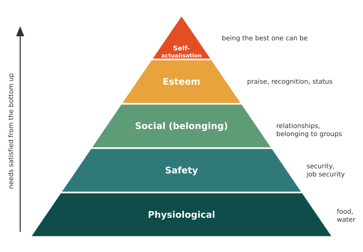

# Leadership and motivation {#sec-leadership}

## Leadership

Leadership is the ability of an individual or a group of individuals to influence and guide followers or other members of an organisation. Leaders help themselves and others to do the right things. They set direction, build an inspiring vision and create something new. Leaders are needed in almost every part of society, from business and politics to religion and community-based organisations.

Leadership means different things to different people around the world, and different things in different situations. An effective leader generally shows the following characteristics:

- self-confidence;
- strong communication and management skills;
- creative and innovative thinking;
- perseverance in the face of failure;
- willingness to take risks;
- openness to change;
- level-headedness and quick response in times of crisis.

Leadership often requires leaders to take on some management tasks, but good leaders understand that their strengths differ from those of good managers. Managers excel at setting out the steps needed to complete tasks and at holding people accountable for their share of the work. A leader shapes and moulds the behaviour of the group towards the goals of the organisation, develops a vision of the future, and motivates members of the organisation to *want* to achieve that vision.

## Types of leadership

Some leaders have one dominant style, while others use different styles in different situations or with different followers. Commonly identified leadership styles are described below.

[**Autocratic**]{.underline}

This is the command-and-control approach. An autocratic leader believes that he or she is the smartest person at the table and knows more than others, and makes all the decisions with little input from team members.

[**Authoritative (visionary)**]{.underline}

Authoritative leaders are confident leaders who map the way and set expectations while engaging and energising their followers. They help people see where the organisation is going and what will happen when it gets there. Unlike autocratic leaders, authoritative leaders take the time to explain their thinking instead of simply issuing orders. Above all, they allow people choice and freedom in how to achieve common goals.

[**Pacesetting**]{.underline}

A pacesetter is a very driven leader who sets the pace, as in a race. Pacesetters set the bar high and push team members to run hard and fast to the finish line. This style is effective in getting things done and driving results, but it can wear team members down. A pacesetting leader needs to ease off from time to time to avoid burning out the team.

[**Democratic**]{.underline}

Democratic leaders share with team members the information that affects their work, and seek their opinions before making a final decision. This builds trust and promotes team spirit and cooperation. It allows for creativity and helps team members grow and develop. A democratic style gets people to do what needs to be done, but in a way that they *want* to do it.

[**Coaching**]{.underline}

A coaching leader sees people as a reservoir of talent to be developed, and seeks to unlock their potential in the belief that everyone has power within themselves. Such a leader gives people a little direction to help them achieve their full potential.

[**Affiliative**]{.underline}

Of all the styles, the affiliative approach is the most personal. An affiliative leader pays attention to and supports the emotional needs of team members. The style is about encouraging harmony and building collaborative relationships within teams.

[**Laissez-faire**]{.underline}

The laissez-faire style is the opposite of the autocratic style and involves the least oversight. A laissez-faire leader appears to trust people to know what to do. This style can work when leading highly skilled, experienced, self-motivated people. To make it effective, the leader should still monitor team performance and give regular feedback.

Because leadership depends on the situation, there is no single best style. The right style is the one that suits the situation the leader is facing.

## Motivation

Motivation is the process that initiates, guides and maintains goal-oriented behaviour. It is what causes you to act, whether that means getting a glass of water to quench your thirst or reading a book to gain knowledge. Motivation involves the biological, emotional, social and cognitive forces that activate behaviour. In everyday use, the word *motivation* describes *why* a person does something; it is the driving force behind human actions.

Motivation refers not only to the factors that start behaviour but also to those that direct and maintain goal-directed action. Motives are rarely observable directly, so we usually have to infer why people do things from their observable behaviour.

### Types of motivation

Motivation is commonly described as either extrinsic or intrinsic.

- **Extrinsic motivation** arises from outside the individual and often involves rewards such as trophies, money, social recognition or praise.
- **Intrinsic motivation** arises from within the individual, as when someone solves a difficult crossword purely for the personal satisfaction of solving it.

### Uses of motivation

Motivation can:

- improve people's efficiency as they work towards goals;
- help people take action;
- encourage people to adopt health-oriented behaviour;
- help people avoid unhealthy or harmful behaviour such as risk-taking and addiction;
- help people feel more in control of their lives;
- improve overall well-being and happiness.

## Theories of motivation

### Maslow's hierarchy of needs

Abraham Maslow described human needs as a hierarchy (@fig-maslow). Needs at the bottom of the hierarchy must be satisfied before an individual moves to the next level and seeks to satisfy those needs [@maslow1943]. Each person's needs keep changing, but at any given time an employer can use the hierarchy to judge what is likely to motivate an employee.

The five levels of the hierarchy are:

1. **Physiological needs:** food, water and other necessities of life.
2. **Safety needs:** freedom from war and natural disasters, and job security.
3. **Social needs:** relationships and belonging to groups.
4. **Esteem needs:** praise, recognition and status.
5. **Self-actualisation needs:** the desire to become the best one can be.

{#fig-maslow fig-alt="A five-level pyramid showing, from bottom to top, physiological, safety, social, esteem and self-actualisation needs, with an arrow indicating that needs are satisfied from the bottom up." width="85%"}

### McClelland's three needs theory

David McClelland's three needs theory holds that each of us has three needs, to a greater or lesser extent [@mcclelland1961]:

- **Need for achievement:** for example, being motivated by setting a new record or by the chance of promotion.
- **Need for affiliation:** for example, being motivated by working with others or by being accepted as part of a group.
- **Need for power:** for example, being motivated by being in charge of others or by holding high status.

### McGregor's Theory X and Theory Y

Douglas McGregor's Theory X and Theory Y place employees in two broad categories [@mcgregor1960].

- **Theory X** assumes that team members are inherently lazy and unmotivated, and will avoid work whenever they can. Management must therefore work continuously to build systems of control and supervision.
- **Theory Y** assumes that team members are ambitious and self-motivated. A Theory Y manager believes that, given the right conditions, team members will perform well.

### Herzberg's two-factor theory

Frederick Herzberg argued that two kinds of factors determine the motivation of employees: motivators and hygiene factors [@herzberg1959].

- **Motivators** encourage employees to work harder when they are present. Examples include an interesting job, advancement and growth.
- **Hygiene factors** do not encourage employees to work harder, but their absence makes employees dissatisfied and demotivated. Examples include working conditions and pay.

: Summary of theories of motivation {#tbl-motivation .bordered}

| Theory | Proposed by | Central idea |
|:-------|:------------|:-------------|
| Hierarchy of needs | Abraham Maslow (1943) | Five levels of needs, satisfied from the bottom up |
| Three needs theory | David McClelland (1961) | Needs for achievement, affiliation and power |
| Theory X and Theory Y | Douglas McGregor (1960) | Two opposing managerial assumptions about employees |
| Two-factor theory | Frederick Herzberg (1959) | Motivators drive effort; hygiene factors prevent dissatisfaction |

::: {.callout-note title="Practical assignment"}
Identify a leader you admire (in your college, community or field of science). Describe the leadership style or styles that person uses, with examples, and explain which theory of motivation best explains how that person motivates others.
:::

## Chapter Summary

### Fill in the blanks {.unnumbered}

Answers are given at the end of the chapter.

1. Leadership is the ability to __________ and guide followers or other members of an organisation.
2. The command-and-control style of leadership is called __________ leadership.
3. The leadership style that involves the least oversight is __________.
4. A leader who sees people as a reservoir of talent to be developed follows the __________ style.
5. Motivation that arises from outside the individual, such as money or praise, is called __________ motivation.
6. The highest level in Maslow's hierarchy of needs is __________.
7. McClelland's three needs are achievement, affiliation and __________.
8. The theory that assumes employees are inherently lazy is Theory __________.
9. In Herzberg's theory, working conditions and pay are examples of __________ factors.

### Short-answer questions {.unnumbered}

1. Define leadership and list the characteristics of an effective leader.
2. How does a leader differ from a manager?
3. Describe the different styles of leadership. Why is there no single best style?
4. Define motivation. Distinguish between extrinsic and intrinsic motivation, with examples.
5. Explain Maslow's hierarchy of needs with a neat diagram.
6. Explain McClelland's three needs theory.
7. Compare McGregor's Theory X and Theory Y.
8. Explain Herzberg's two-factor theory with examples of motivators and hygiene factors.

### Quick revision {.unnumbered}

- Leadership → influencing and guiding others towards a shared vision.
- Styles → autocratic, authoritative, pacesetting, democratic, coaching, affiliative, laissez-faire.
- Leadership is situational → no single best style.
- Motivation → initiates, guides and maintains goal-oriented behaviour.
- Extrinsic → rewards from outside; intrinsic → satisfaction from within.
- Maslow → physiological → safety → social → esteem → self-actualisation.
- McClelland → achievement, affiliation, power.
- McGregor → Theory X (lazy, needs control) versus Theory Y (ambitious, self-motivated).
- Herzberg → motivators (job, growth) versus hygiene factors (conditions, pay).

### Answers to fill in the blanks {.unnumbered}

::: {.answer-key}
`1.` influence `2.` autocratic `3.` laissez-faire `4.` coaching `5.` extrinsic `6.` self-actualisation `7.` power `8.` X `9.` hygiene
:::

